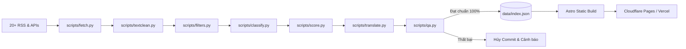

# Tech Tips Hub 💡

> **Web tự động tổng hợp thủ thuật & mẹo công nghệ tinh chọn từ khắp nơi trên thế giới, hiển thị song ngữ VI/EN và tôn trọng bản quyền. Chi phí phụ thuộc hạn mức và chính sách của nhà cung cấp dịch vụ.**

[](https://github.com/nhattranhuynhthien/tech-tips-hub/actions/workflows/fetch.yml)
[](LICENSE)
[](https://meocongnghe.vercel.app/vi/about)
[](https://astro.build)

---

## 📖 1. Giới thiệu

**Tech Tips Hub** (`tips.hub`) là nền tảng tổng hợp (aggregator) thủ thuật công nghệ thực chiến, tối giản và tốc độ cao dành cho lập trình viên và người đam mê công nghệ:
* **Hệ điều hành:** Windows, macOS, Linux, Android, iOS.
* **Công cụ & Phần mềm:** Trình duyệt web (Chrome, Firefox, Edge, Safari), Công cụ văn phòng (Excel, Docs, Sheets, Notion).
* **Kỹ thuật & An toàn:** Bảo mật & Quyền riêng tư, Công cụ AI (Prompt, ChatGPT, Claude, Ollama, DeepSeek), Lập trình & DevOps (Docker, Git, VS Code, Python), Phần cứng & Mạng (WiFi, SSD, GPU, RAM).

### 5 Nguyên tắc cốt lõi:
1. **Ưu tiên chi phí thấp:** Dùng GitHub Actions và dịch vụ lưu trữ tĩnh. Chi phí của API bên thứ ba phụ thuộc hạn mức và chính sách hiện hành của nhà cung cấp.
2. **Nguyên tắc Fair Use:** Chỉ lưu trữ tiêu đề chuẩn hóa, tóm tắt cô đọng (~280–300 ký tự) và đường dẫn gốc. Tuyệt đối không đăng lại nguyên bài viết của tác giả.
3. **Minh bạch & Tôn trọng bản quyền:** Luôn trích dẫn rõ nguồn, tên tác giả, ngày xuất bản; cung cấp cơ chế gỡ bài và báo cáo lỗi dịch thuật qua GitHub Issues.
4. **Tĩnh trước, động sau:** Kiến trúc Static Site Generation (SSG) với Astro đạt chuẩn Lighthouse $\ge 90$, tải trang cực nhanh (&lt; 0.5s), không dùng cơ sở dữ liệu động.
5. **Dữ liệu sạch & Kiểm định gắt gao:** Quy trình QA độc lập chạy trước mỗi lần cập nhật. Dữ liệu chỉ được commit nếu đạt chuẩn 100% tiêu chí.

---

## 🏗️ 2. Kiến trúc Hệ thống



### Chi tiết các tầng xử lý:
* **Làm sạch ([`scripts/textclean.py`](file:///d:/Random_v2/scripts/textclean.py)):** Giải mã HTML entities vòng lặp (kể cả mã hóa kép `&amp;ecirc;`), gỡ tag HTML, loại boilerplate quảng cáo, cắt gọt tóm tắt trùng tiêu đề.
* **Bộ lọc ([`scripts/filters.py`](file:///d:/Random_v2/scripts/filters.py)):** Phân định nguồn `tips` vs `news`. Chặn toàn bộ bài viết deal, giảm giá, `[QC]`, tuyển dụng, trailer. Ghi nhận nhật ký loại bỏ vào `data/logs/rejected.jsonl`.
* **Phân loại ([`scripts/classify.py`](file:///d:/Random_v2/scripts/classify.py)):** Phân loại 11 danh mục theo ranh giới từ `\b`. Nhân đôi trọng số tiêu đề; giới hạn tối đa 2 danh mục/bài.
* **Chấm điểm ([`scripts/score.py`](file:///d:/Random_v2/scripts/score.py)):** Kết hợp trọng số nguồn, suy giảm theo độ mới (recency decay), hệ số how-to và tín hiệu cộng đồng (HN points, Dev.to reactions).
* **Dịch song ngữ ([`scripts/translate.py`](file:///d:/Random_v2/scripts/translate.py)):** Dịch NGUYÊN CÂU theo lô qua giao diện `Translator`:
  * *Chính:* Google Gemini API (`GEMINI_MODEL`, mặc định `gemini-2.5-flash`) kèm retry Exponential Backoff khi gặp lỗi 429.
  * *Dự phòng:* Endpoint Google Translate công khai; Argos Translate offline là lớp dự phòng cuối nếu đã cài model.
  * Tiêu đề và tóm tắt được gửi tới nhà cung cấp dịch thuật khi cần dịch; cân nhắc chính sách dữ liệu của nhà cung cấp khi vận hành.
  * Kiểm duyệt bằng `looks_vietnamese` và `is_mixed`. Nếu dịch thất bại hoặc không đạt kiểm tra, giữ nguyên bản gốc và không gắn nhãn dịch máy.
* **Cổng kiểm định chất lượng ([`scripts/qa.py`](file:///d:/Random_v2/scripts/qa.py)):** Chặn commit nếu còn mã entity, câu trộn ngữ pháp, bài dán nhãn dịch giả dối, tóm tắt rỗng hoặc danh mục trung bình > 2.0. Đẩy báo cáo chi tiết vào **GitHub Job Summary**.
* **Phân trang & Giao diện:** Phân trang Astro `paginate()` 20 bài/trang (`/vi/page/2`, `/en/page/2`), typography chuyên sâu (Lexend, Be Vietnam Pro, JetBrains Mono), chuẩn WCAG AA và Dark Terminal Hub phong cách.

---

## 📁 3. Cấu trúc Thư mục

```text
tech-tips-hub/
├── .github/workflows/
│   └── fetch.yml               # Cron mỗi giờ + QA gate
├── config/
│   ├── sources.json           # Danh sách nguồn, trạng thái bật/tắt và loại nội dung
│   ├── filters.json           # Từ khóa giữ/loại và ngưỡng chất lượng
│   ├── sources.notes.md       # Kết quả kiểm tra nguồn và lý do tắt
│   ├── categories.yml          # Định nghĩa 11 danh mục và màu sắc
│   └── blocklist.yml           # Danh sách từ khóa bị chặn
├── scripts/
│   ├── fetch.py                # Thu thập dữ liệu RSS & API
│   ├── textclean.py            # Giải mã entities và chuẩn hóa văn bản
│   ├── filters.py              # Bộ lọc how-to & blocklist
│   ├── classify.py             # Phân loại danh mục theo từ khóa
│   ├── score.py                # Tính điểm chất lượng và độ khó
│   ├── translate.py            # Động cơ dịch thuật (Gemini / Argos offline)
│   ├── run_pipeline.py         # Điều phối toàn bộ quy trình
│   ├── migrate.py              # Migration dữ liệu cũ an toàn
│   └── qa.py                   # Kiểm định chất lượng và xuất Job Summary
├── tests/
│   └── test_translate.py       # Bộ unit test cho module dịch thuật
├── data/
│   ├── index.json              # Kho dữ liệu thủ thuật đang hoạt động
│   ├── history_featured.json   # Lịch sử Mẹo hay hôm nay (không lặp 14 ngày)
│   ├── logs/rejected.jsonl     # Nhật ký bài viết bị loại
│   └── cache/translations.json # Bộ nhớ cache bản dịch đã kiểm định
├── src/
│   ├── i18n/                   # Từ điển giao diện EN / VI
│   ├── layouts/Layout.astro    # Khung giao diện chuẩn Terminal Dark
│   ├── components/             # TipCard, TrickOfTheDay, Pagination, SearchModal
│   ├── styles/global.css       # Design tokens, màu sắc WCAG AA
│   └── pages/                  # Các route tĩnh VI/EN, phân trang, chi tiết bài
├── package.json
└── README.md
```

---

## 🚀 4. Hướng dẫn Chạy Cục bộ

### Yêu cầu:
* **Node.js**: v18.0+
* **Python**: v3.10+

### Bước 1: Cài đặt dependencies
```bash
# Cài đặt giao diện Astro
npm install

# Khởi tạo và kích hoạt Python venv
python -m venv .venv
# Trên Windows:
.\.venv\Scripts\activate
# Trên Linux/macOS:
source .venv/bin/activate

pip install -r scripts/requirements.txt
```

### Bước 2: Chạy kiểm thử tự động
```bash
# Chạy bộ unit test dịch thuật
python tests/test_translate.py

# Chạy kiểm định chất lượng dữ liệu (QA)
python scripts/qa.py
```

### Bước 3: Thu thập và cập nhật dữ liệu mới (Tùy chọn)
```bash
# Thiết lập API key nếu có (tùy chọn)
export GEMINI_API_KEY="your-gemini-key"
export GEMINI_MODEL="gemini-2.5-flash"

python scripts/run_pipeline.py
```

### Bước 4: Khởi chạy môi trường Dev
```bash
npm run dev
```
Truy cập trình duyệt: `http://localhost:4321/vi` hoặc `http://localhost:4321/en`.

### Bước 5: Build bản Production
```bash
npm run build
```
Đầu ra tại thư mục `dist/` sẵn sàng triển khai thẳng lên Cloudflare Pages hoặc Vercel.

---

## 🔐 5. Thiết lập Biến môi trường (CI/CD)

Trong cài đặt GitHub Repository (**Settings > Secrets and variables > Actions**):
* `GEMINI_API_KEY` *(Repository Secret)*: Khóa Google Gemini API miễn phí (lấy tại Google AI Studio).
* `GEMINI_MODEL` *(Repository Variable - Tùy chọn)*: Tên model Gemini muốn dùng (mặc định: `gemini-2.5-flash`).

---

## 🛡️ 6. Giấy phép & Bản quyền

* Mã nguồn được phát hành theo giấy phép **MIT License**.
* Toàn bộ nội dung bài viết, thương hiệu và hình ảnh thuộc về tác giả và trang tin gốc. Tech Tips Hub hoạt động như một công cụ lập chỉ mục hỗ trợ dẫn link về bài gốc.

Telegram inbox setup: [docs/telegram-inbox.md](docs/telegram-inbox.md).
